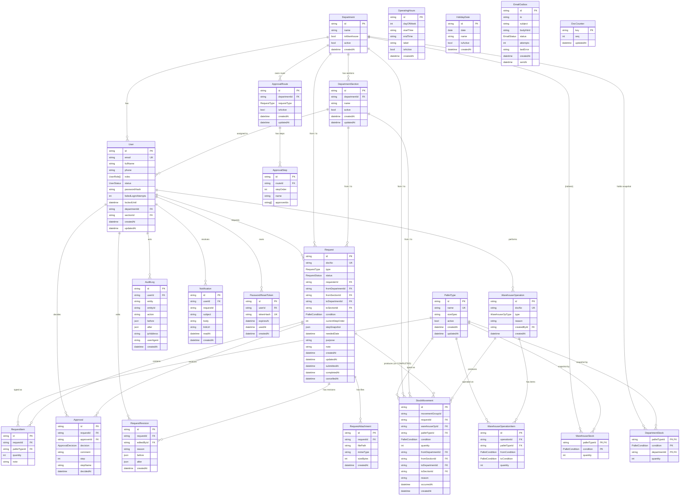

# ER Diagram — ระบบเบิกจ่ายพาเลท

เอกสารนี้สะท้อนโครงสร้างข้อมูลจริงใน `prisma/schema.prisma` (อัปเดต 2026-10-21)

> หลักการที่ยึดในการออกแบบ (ตาม `CLAUDE.md`):
> 1. นับยอดแบบ bulk ไม่ติดตามรายตัว (ไม่มี serial/QR)
> 2. ยอดคลัง = `WarehouseStock` (snapshot) + `StockMovement` (ledger) อัปเดตใน transaction เดียวกัน
> 3. ทุก movement มีทิศทาง `fromDepartmentId` (ออก) / `toDepartmentId` (เข้า)
> 4. ผู้ร้องขอ ≠ ผู้อนุมัติ (บังคับที่ service layer)
> 5. การอนุมัติเป็น multi-step; ขั้นสุดท้ายคือ `PALLET_MANAGER` เสมอ

---

## 1. ภาพรวม (Mermaid)



---

## 2. Enums

| Enum | ค่า |
|---|---|
| `UserRole` | `REQUESTER`, `DEPT_APPROVER`, `PALLET_MANAGER`, `VIEWER`, `ADMIN` |
| `UserStatus` | `PENDING`, `ACTIVE`, `DISABLED` |
| `PalletCondition` | `GOOD` (ดี), `PENDING_REPAIR` (รอซ่อม), `DAMAGED` (เสีย/รอตัดจำหน่าย) |
| `RequestType` | `ISSUE` (เบิกออก), `RETURN` (คืนเข้า) |
| `RequestStatus` | `DRAFT`, `PENDING_DEPT`, `PENDING_WAREHOUSE`, `COMPLETED`, `REJECTED`, `CANCELLED` |
| `ApprovalDecision` | `APPROVED`, `REJECTED`, `EDIT_APPROVED` |
| `WarehouseOpType` | `REPAIR_RESULT`, `WRITE_OFF`, `ADJUSTMENT` |
| `EmailStatus` | `PENDING`, `SENT`, `FAILED` |

> **หมายเหตุ**: `User.roles` เป็น `UserRole[]` — 1 user ถือได้หลาย role (เช่น REQUESTER + DEPT_APPROVER)

---

## 3. หลักการสำคัญที่โค้ดบังคับ

### 3.1 Single source of truth
`stock_movements` เป็น **append-only ledger**
```
balance(palletType, condition, dept) = Σ(moves in) − Σ(moves out)
```
ตาราง `WarehouseStock` / `DepartmentStock` คือ **snapshot** ที่คำนวณพร้อมกันกับการเขียน ledger ภายใน `prisma.$transaction` เดียวกัน (ดู `lib/server/stock/index.ts`)

### 3.2 คลังพาเลท
- ไม่ใช้ `code = "WH-PL"` อีกต่อไป → ใช้ **`Department.isWarehouse = true`** ซึ่งต้องมี 1 แผนก และ `active = true`
- `isWarehouse` เป็น business flag ไม่ใช่ constraint ที่ DB บังคับ (service layer ตรวจเอง)

### 3.3 Routing อัตโนมัติ
ผู้ใช้ **ไม่ต้องเลือก from/to** — service กำหนดอัตโนมัติตามประเภท:

| Type   | fromDepartment       | toDepartment         |
|--------|----------------------|----------------------|
| ISSUE  | warehouse (คลัง)     | requester.department |
| RETURN | requester.department | warehouse (คลัง)     |

`sectionId` ถูก snapshot จาก `user.sectionId` ณ เวลาสร้างคำขอ

### 3.4 ป้องกันยอดติดลบ
`moveStock()` ใช้ **conditional UPDATE** เพื่อป้องกัน race:
```sql
UPDATE warehouse_stock
SET    quantity = quantity - :delta
WHERE  "palletTypeId" = :pt
  AND  condition = :cond
  AND  quantity >= :delta;
```
ถ้า 0 rows affected → throw `HttpError(400, "ยอด ... ไม่พอ")`

> `DepartmentStock` **ไม่ป้องกันติดลบ** เพราะ BR-3 (คืนเกินยอดเบิกไม่บล็อก)

### 3.5 Snapshot ของ approval route
`Request.stepSnapshot` เก็บ `[{stepOrder, name, approverIds}]` ไว้ ณ ตอน submit
→ Admin แก้ `ApprovalRoute` ภายหลัง **ไม่กระทบ** คำขอที่ค้างอยู่ (AC-12)

### 3.6 เลขเอกสาร (`DocCounter`)
Atomic increment ด้วย raw SQL `INSERT ... ON CONFLICT ... DO UPDATE RETURNING seq`

| ประเภท | Pattern | ตัวอย่าง |
|---|---|---|
| Request ISSUE | `PL-ISS-YYMM-NNNN` | `PL-ISS-2610-0001` |
| Request RETURN | `PL-RET-YYMM-NNNN` | `PL-RET-2610-0042` |
| Warehouse REPAIR | `WO-REP-YYMM-NNNN` | `WO-REP-2610-0001` |
| Warehouse WRITE_OFF | `WO-WOF-YYMM-NNNN` | `WO-WOF-2610-0003` |
| Warehouse ADJUSTMENT | `WO-ADJ-YYMM-NNNN` | `WO-ADJ-2610-0012` |

### 3.7 Append-only tables
`StockMovement`, `Approval`, `RequestRevision`, `AuditLog`, `WarehouseOperation` — ห้ามเขียนโค้ด update/delete

### 3.8 Soft-delete
`Department`, `DepartmentSection`, `PalletType`, `ApprovalRoute`, `OperatingHours`, `HolidayDate` → ใช้ `active`/`isActive` flag แทนลบจริง เพื่อรักษา FK ของประวัติ

### 3.9 User lockout
`User.failedLoginAttempts` + `lockedUntil` — login ผิด 5 ครั้ง ล็อก 15 นาที (จัดการที่ service login)

---

## 4. Query ตัวอย่าง

### 4.1 ยอดในคลัง (ใช้ snapshot)
```sql
SELECT "palletTypeId", condition, quantity
FROM warehouse_stock
WHERE quantity > 0
ORDER BY "palletTypeId", condition;
```

### 4.2 ยอดในคลัง (ตรวจกับ ledger — invariant check)
```sql
SELECT m."palletTypeId", m.condition,
       SUM(CASE WHEN d."isWarehouse" THEN
             CASE WHEN m."toDepartmentId"   = d.id THEN  m.quantity
                  WHEN m."fromDepartmentId" = d.id THEN -m.quantity
                  ELSE 0 END
           ELSE 0 END) AS calculated_qty
FROM   stock_movements m
JOIN   departments d
       ON  d.id IN (m."toDepartmentId", m."fromDepartmentId")
       AND d."isWarehouse" = true
GROUP  BY m."palletTypeId", m.condition;
-- ค่าต้องเท่ากับ warehouse_stock.quantity (AC-14)
```

### 4.3 คำขอที่กำลัง reserve ยอดคลังอยู่ (soft-reserve)
```sql
SELECT ri."palletTypeId", r.condition, SUM(ri.quantity) AS reserved
FROM   request_items ri
JOIN   requests r ON r.id = ri."requestId"
WHERE  r.status IN ('PENDING_DEPT', 'PENDING_WAREHOUSE')
   AND r.type   = 'ISSUE'
GROUP  BY ri."palletTypeId", r.condition;
```

### 4.4 ยอดที่เบิกได้จริง (available = snapshot − reserved)
ใช้ `lib/services/request.ts::getAvailableBalance()`

### 4.5 ยอดเบิก-คืน รายแผนก (dashboard)
```sql
SELECT d.name,
       SUM(CASE WHEN m."toDepartmentId"   = d.id AND d."isWarehouse" = false
                 AND wh_m."fromDepartmentId" IS NOT NULL
                THEN m.quantity ELSE 0 END) AS issued,
       SUM(CASE WHEN m."fromDepartmentId" = d.id AND d."isWarehouse" = false
                THEN m.quantity ELSE 0 END) AS returned
FROM   stock_movements m
JOIN   departments d ON d.id IN (m."toDepartmentId", m."fromDepartmentId")
WHERE  m."occurredAt" >= :from AND m."occurredAt" < :to
GROUP  BY d.id, d.name;
```

---

## 5. Index สำคัญ (performance)

| Table | Index | เหตุผล |
|---|---|---|
| `users` | `(status)` | admin filter PENDING users |
| `requests` | `(status, type)`, `(requesterId, status)`, `(createdAt)` | รายการคำขอ + queue อนุมัติ |
| `stock_movements` | `(palletTypeId, condition)`, `(fromDepartmentId)`, `(toDepartmentId)`, `(occurredAt)` | dashboard aggregations |
| `audit_logs` | `(entity, entityId)`, `(userId, createdAt)` | ตรวจย้อนรายการ |
| `email_outbox` | `(status, createdAt)` | cron picker (PENDING FIFO) |
| `warehouse_operations` | `(type, createdAt)` | dashboard แยกประเภท |
| `notifications` | `(userId, createdAt)` | inbox ของ user |

---

## 6. Database connection

- **Runtime** (Vercel): `DATABASE_URL` = Supabase Supavisor pooled (port 6543, transaction mode, `?pgbouncer=true&connection_limit=1`)
- **Migration**: `DIRECT_URL` = direct connection (port 5432) — ใช้โดย `prisma migrate`
- **RLS**: ไม่พึ่ง Supabase RLS สำหรับ business rule (ใช้ Prisma เป็นเดียว); ต้องปิดการเข้าถึงผ่าน anon key ที่ตั้ง policy เพื่อ safety
